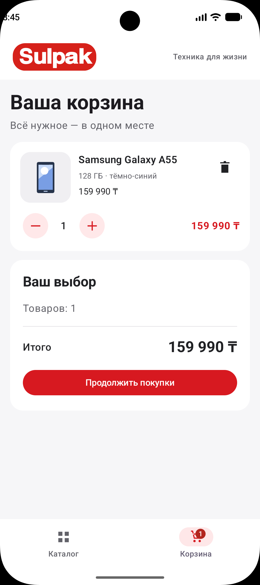

# Sulpak Shop

Учебное Android-приложение магазина электроники на **Kotlin**, **Jetpack Compose**, **Material 3** и **ViewModel**. Проект HW2 выполнен в красно-белом оформлении по мотивам [магазина Sulpak](https://www.sulpak.kz/).

Каталог содержит восемь демонстрационных товаров. Данные и цены заданы локально и не являются актуальными предложениями магазина. Приложение работает без сети; реальная оплата и оформление заказов не подключены.

## Возможности

- **Каталог:** карточки товаров с иллюстрацией, названием, характеристиками и ценой в тенге.
- **Поиск:** по названию и описанию без учёта регистра, с очисткой запроса.
- **Категории:** смартфоны, ноутбуки, аудио и техника для дома.
- **Избранное:** добавление и удаление товаров, фильтр «Только избранное».
- **Корзина:** добавление товаров, изменение количества от 1 до 99 и удаление позиции. Уменьшение количества до нуля удаляет товар.
- **Расчёт стоимости:** сумма каждой позиции, общее количество и итоговая сумма обновляются сразу.
- **Навигация:** переключение каталога и корзины с индикатором количества товаров.
- **Состояние:** поиск, категории, избранное и корзина сохраняются при повороте благодаря ViewModel; выбранный раздел — через `rememberSaveable`.
- **Оформление:** светлая и тёмная темы Material 3, прокрутка, сообщения для пустой корзины и отсутствующих результатов.

Корзина и избранное хранятся в памяти. После завершения процесса или закрытия Activity с последующим новым запуском они могут сброситься.

## Скриншоты

Скриншоты новой версии находятся в папке [`screenshots`](screenshots/).

| Каталог товаров | Корзина и расчёт стоимости |
| --- | --- |
|  |  |

| Фильтрация по категории | Поиск товара |
| --- | --- |
|  |  |

## Технологии и структура

```text
app/src/main/java/com/example/myapplication/
├── MainActivity.kt
├── model/
│   ├── Product.kt            # Товар, категория и позиция корзины
│   └── ShopCatalog.kt        # Демонстрационные товары и цены
├── viewmodel/
│   ├── ShopUiState.kt        # Состояние, фильтры и итоговые суммы
│   └── ShopViewModel.kt      # Обработка действий пользователя
└── ui/
    ├── ShopScreen.kt         # Экран и подключение ViewModel
    ├── components/
    │   ├── CatalogFilters.kt # Поиск, категории, фильтр избранного
    │   ├── ProductCard.kt    # Карточка товара
    │   ├── CartComponents.kt # Позиция корзины, количество, итог
    │   └── ShopCommon.kt     # Заголовок, баннер, иллюстрации, пустые состояния
    └── theme/               # Цвета и тема Material 3
```

UI собирает `StateFlow` через `collectAsStateWithLifecycle()` и передаёт события во ViewModel через обработчики. ViewModel публикует новое неизменяемое состояние, после чего Compose обновляет интерфейс. Локальные векторные иллюстрации отображаются через `Image`; для компоновки используются `LazyColumn`, `Card`, `Row`, `Column` и `Box`.

## Требования

- Android Studio с поддержкой указанных в проекте Android Gradle Plugin и Gradle.
- Android SDK Platform **37** и необходимые SDK Build Tools.
- JDK **25** для Gradle Daemon, как указано в `gradle/gradle-daemon-jvm.properties`.
- Эмулятор или устройство с **Android 7.0 / API 24** или новее.
- Интернет для первой загрузки Gradle и зависимостей.

Gradle Wrapper включён в проект: отдельная установка Gradle не требуется.

## Запуск в Android Studio

1. Открыть папку **`MyApplication`**, содержащую `settings.gradle.kts`.
2. Указать расположение Android SDK на своём компьютере. Android Studio создаёт `local.properties` с параметром `sdk.dir`.
3. Дождаться завершения **Gradle Sync** и установить недостающие SDK-компоненты, если IDE предложит.
4. Запустить эмулятор через Device Manager либо подключить телефон с отладкой по USB.
5. Выбрать конфигурацию **app**, устройство и нажать **Run**.

Откроется каталог Sulpak Shop. Нажмите «В корзину» на карточке товара и перейдите в раздел «Корзина» внизу экрана.

## Сборка через терминал

Команды выполняются из папки `MyApplication`. Для запуска Wrapper должен быть настроен Java (`JAVA_HOME` или `PATH`); версия JDK для Gradle Daemon задана в проекте.

**macOS / Linux:**

```sh
./gradlew :app:assembleDebug
```

**Windows PowerShell:**

```powershell
.\gradlew.bat :app:assembleDebug
```

APK: **`app/build/outputs/apk/debug/app-debug.apk`**.

Для установки на запущенный эмулятор или подключённое устройство:

```sh
./gradlew :app:installDebug
```

После установки открыть **Sulpak Shop** на устройстве. В Windows используйте `.\gradlew.bat` вместо `./gradlew`.

## Проверки

```sh
./gradlew :app:testDebugUnitTest :app:lintDebug
```

Тесты интерфейса требуют эмулятора или подключённого устройства:

```sh
./gradlew :app:connectedDebugAndroidTest
```

`ShopViewModelTest` проверяет совместную работу поиска, категорий и избранного, расчёт корзины, удаление, ограничение количества и обработку неизвестного ID.

`ShopScreenTest` проверяет поиск, категорию, избранное, количество товаров и сохранение состояния после `ActivityScenario.recreate()`. Отдельный сценарий сохраняет скриншоты каталога и корзины во внешнюю папку приложения на тестовом устройстве.

### Демонстрация пересоздания Activity

1. Найти «Samsung», выбрать «Смартфоны», добавить товар в избранное и включить «Только избранное».
2. Добавить товар в корзину, открыть её и увеличить количество до двух.
3. Повернуть устройство: раздел «Корзина», количество и итоговая сумма должны сохраниться.
4. Вернуться в каталог: поиск, категория, избранное и соответствующий фильтр должны сохраниться.
5. На длинном списке отдельно проверить сохранение позиции прокрутки.

| Механизм | Применение | Поведение |
| --- | --- | --- |
| `remember` | `NumberFormat` в `priceText()` | Сохраняет вспомогательный объект между рекомпозициями; после пересоздания UI создаёт новый |
| `rememberSaveable` | Выбранный раздел `showCart` | Восстанавливает небольшое состояние UI при пересоздании Activity |
| `ViewModel` | Корзина, избранное, запрос, категория | Хранит состояние и логику экрана при изменении конфигурации |

Прокруткой управляет `rememberLazyListState()`, поддерживающий сохранение позиции. ViewModel сам по себе не переживает завершение процесса; постоянное хранилище в учебной версии не реализовано.
